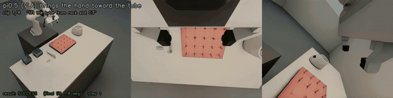
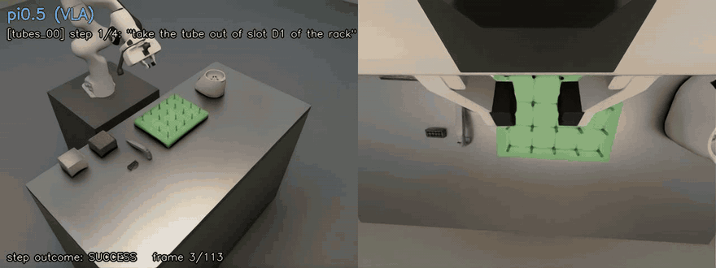

# Biotech Lab Robotics

A Franka Panda working a biotech lab bench (test tubes, centrifuge,
electronic pipette, sample tray), simulated physically in Isaac Sim. The
robot runs lab primitives from plain-language instructions: Physical
Intelligence's π0.5 VLA handles the instruction and the gross motion, and
reinforcement-learning policies trained in Isaac Lab take over near the
target for the precise part. A separate pipeline measures a real lab scene
into sim assets.

| Directory | What it is |
|---|---|
| [`simulation/`](simulation/README.md) | Isaac Sim lab scene, scripted expert and randomized episode generator, LeRobot export and π0.5 fine-tuning (`sim/`, `training/`), RL policies in Isaac Lab (`rl/`), evaluation and multi-step scenarios |
| [`vision_pipeline/`](vision_pipeline/README.md) | Real scene → measured 3D CAD: calibrated multi-view capture to meshes, labels and placements for the sim |

The Python environments (`.venv-isaac`, `.venv-isaaclab`, `.venv-cad`) and
generated data (`data/`) live in the workspace folder above this repo; CAD
generation and measurement scripts are in `../cad_source/`.

## Status (6 Nov 2026)

All work so far is in simulation (Isaac Sim 6.0.1 / Isaac Lab 3.0) on one
12 GB GPU.

### Now: RL that drives the joints directly (no IK)

The first RL teachers (below, 2 Nov) moved the hand through IK and finished
with a scripted lift. They are being replaced by policies that output a change
of each of the 7 joint targets plus the gripper at 15 Hz. The policy learns
the grasp orientation, the close and the whole lift; nothing is scripted.
π0.5 hands over **the moment the hand enters a sphere around the target**
(28 cm for the tube pick), without waiting for π0.5 to stall or fail.



Tube picks with the domain-randomized policy. Blue: π0.5 drives. Green: the
RL policy has taken over. Teal: it holds the tube for the 1 s success check.
[Full video](docs/media/joint_rl_tube_pick_dr.mp4) (60 s, 8 picks including
its one miss).

| Skill | Isaac Lab | Generator (π0.5 + RL) | State |
|---|---|---|---|
| Pick tube from rack | 98/100 | **30/30** (20/20 camera pose, 10/10 true pose) | done |
| … domain-randomized version | 92.4% under randomized dynamics (run 10 without randomization: 63.2%); 91/100 nominal | 29/30 | candidate for a physical arm |
| Remove tube from centrifuge bore | 69/100 (held start 89%, approach 50–64%) | not hooked up yet | more training queued |
| Insert tube into centrifuge bore | 19/100 (from inside the bore 82%, from a carry 0%) | – | training; entering the 0.5 mm-clearance bore is not learned yet |
| Pick up pipette | held start 100%, approach < 10 cm 50%, further 0% | – | training |
| Attach tip, aspirate / dispense position | envs built and tested | – | queued |
| Pick up tray, place tray | envs built and tested | – | queued |

[Centrifuge clips in Isaac Lab](docs/media/centrifuge_rl_isaaclab.mp4) (71 s,
the RL policies alone): remove 8 of 8, insert from inside the bore 4 of 4,
insert from a carry 0 of 4.

**Reward.** All skills use one template
([explained in full](docs/reward_function_joint_rl.pdf)):

```
r = [Φ(s′) − Φ(s)] + 100·success − 20·fail + small per-step costs
```

- **Φ** scores progress, for example: reach, hand on the approach line, hand
  oriented, descend, held, lifted × upright. It is undiscounted, so waiting
  earns nothing. A discounted version made policies back away from targets
  they couldn't finish yet.
- **Success** has to hold for 5–15 steps.
- **Per-step costs** cover tilting the held object, moving fast near it,
  closing early and jerky actions.

**What made it learnable:**
- **Reverse curricula:** 20–40% of starts are already held, and others are
  lined up at the bore or just before the expert's grasp.
- **Gripper:** biased closed for picks; a release interlock for insert and
  tray place, where the gripper may only open inside the bore or at the spot.
- **Alignment terms:** smooth cosine shapes, so a hand 160° off still has a
  direction to turn.

Shared code: [`simulation/rl/joint_space.py`](simulation/rl/joint_space.py)
and one `rl/*_joint/` package per skill.

**Hand-over region.** From 1,024 Isaac Lab starts, the tube-pick policy
succeeds 96–100% at every start distance out to 35 cm
([`rl/eval_handover_region.py`](simulation/rl/eval_handover_region.py)). A
20 cm sphere gave 29/30 in the generator, because π0.5 hovered just outside
it; 28 cm gave 30/30.

**Towards a physical arm.** The domain-randomized fine-tune randomizes, per
env:
- arm and finger gains;
- finger-pad friction;
- 0–67 ms control latency;
- joint-encoder and TCP calibration offsets;
- joint noise.

Not yet randomized: the tubes' own friction and mass, which Isaac Lab's
events don't support for the rack's tube collection. The bring-up path:

1. Match the sim layout to the real cell, and calibrate the cameras and fixtures.
2. Check that the real arm tracks the joint commands as the sim does.
3. Build a ROS 2 bridge that feeds the policy the same observation vector.
4. Run in shadow mode, then in the air, then the tube pick at reduced speed.
5. Fine-tune π0.5 on real images last.

### Earlier: π0.5 + IK-based RL finisher (2 Nov)



One continuous scene, four steps, all four succeed (2.5× speed). The tube
pose comes from the wrist-camera localizer.
[Full video of all four scenarios](docs/media/vla_rl_finisher_scenarios.mp4).

- **π0.5:** `pi05_droid` fine-tuned with LoRA via openpi (52M trainable
  parameters, vision encoder frozen to fit 12 GB), action normalization from
  our own data, 4 runs of up to 15k steps.
- **Training data:** 766 physically validated expert episodes (145,831
  frames at 15 Hz) from a scripted expert with a collision-checked planner.
  The data is randomized in:
  - appearance, empty slots and liquids;
  - placement, including whole-desk layouts that also move the arm base;
  - varied start poses and chained tasks;
  - recovery episodes from π0.5's failures.
- **RL teachers:** PPO in Isaac Lab, a hand move of up to 1 cm per step
  through IK, a hand-over when π0.5 stalled, closed, was about to release, or
  ran out of time.

| Task | π0.5 alone | π0.5 + IK RL teacher |
|---|---|---|
| Pick tube from rack (camera-estimated pose) | 0 | 20/20 |
| Pick up sample tray | 0/5 | 10/10 |
| Pick up pipette | 0/5 | 10/10 |
| Place tube into rack slot | – | 7/10 |
| Insert tube into centrifuge bore | – | 0/9 |
| Attach tip / aspirate / dispense | – | 0/10 each |

π0.5 learns smooth motion but not *which* target the prompt names, nor
millimetre precision. The RL policies do the precise contact work once the
arm is near the target.

### Next

- Finish training the joint-space skills: pipette, tip attach, pipetting
  position, tray pick and place, more centrifuge remove and insert.
- Hook each into the generator with the sphere hand-over and evaluate it with
  π0.5, as for the tube pick.
- Domain-randomize the remaining skills, then bring up the tube pick on the
  real arm.
